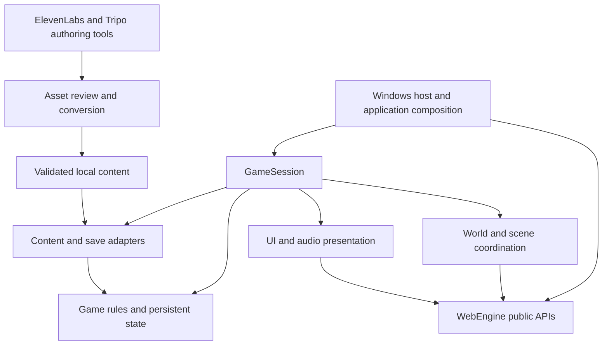

# The Shattered Sea Architecture

This is the technical architecture for the 3D RPG described in the
[game concept](game-concept.md). It defines the intended system boundaries,
ownership, world representation and delivery sequence for the native Windows
game. The existing starter is the implementation baseline; the game systems
below are planned unless explicitly listed as implemented.

## 1. Scope and decisions

| Decision | Architecture |
| --- | --- |
| Initial platform | Windows x64, C++20, MSVC, CMake and WebEngine's native desktop host |
| Renderer | Direct D3D12 through `WebEngine::Desktop`; renderer internals remain engine owned |
| Initial game mode | Single-player, offline play with local saves |
| Camera | Third-person view during exploration and turn-based combat |
| Combat | Turn-based encounters with explicit initiative, action points and movement allowance |
| World scale | Thousands of catalogued islands, with a bounded playable area loaded at a time |
| Content model | Authored locations and stories, reusable prefabs, seeded variation where appropriate |
| Quantum fantasy | Explicit gameplay rules for coherence, probability distance and resonance |
| Generation services | ElevenLabs and Tripo are authoring tools; the shipped game consumes reviewed local assets |

Multiplayer, a browser build, a fully seamless planet, continuous simulation of
every island and general-purpose runtime scripting are outside the initial
scope. They would require separate architectural decisions.

## 2. Current implementation

The repository currently contains:

- A pinned `external/WebEngine` submodule at
  `56080eca124c9a62e15b146799a8004bdad5a9b2`.
- `src/main.cpp`, which creates one `DesktopHost`, loads a scene, registers its
  camera and runs the engine loop. Escape closes the game; F11 toggles fullscreen.
- `src/game_scene.cpp`, which builds a static lit clearing with primitive ground,
  player and landmark placeholders.
- Windows setup scripts, CMake presets and a GitHub Actions build with an
  executable `--help` check.
- A shared `rpg_scene` target linked by both the Windows game and headless C++
  integration tests. Linux cloud setup and CI compile this scene and test camera
  resolution, scene collection, pause/resume, replacement and shutdown without
  a renderer. `RPG_BUILD_DESKTOP` selects Windows composition, while
  `RPG_BUILD_TESTS` independently enables game tests; engine tests stay disabled.
  See [Codex cloud setup](codex-cloud.md) for environment preparation.
- Python authoring clients for ElevenLabs speech and Tripo text-to-GLB generation,
  with offline tests, dry runs and environment-based credentials.

Movement, combat, shipping, world streaming, quests, dialogue, gameplay audio and
game saves are not yet implemented. CI has verified the native build and command
line entry point; this does not establish GPU rendering acceptance. The optional
Dawn backend is disabled because the pinned engine hits an MSVC shader-string
size limit on that path.

## 3. Dependency boundaries



Game rules do not include SDL, Direct3D, provider SDKs or private engine headers.
They operate on typed commands, stable IDs and bounded state. Runtime adapters
translate between those rules and engine actors/components. Presentation reads
committed state and requests commands; it cannot grant rewards or modify world
state directly.

Use existing public engine mechanisms for scenes, resources, physics, navigation,
GUI, audio and asset loading. Add reusable engine functionality upstream only
when a demonstrated game need cannot be expressed through those mechanisms.
An engine change requires its own review, validation and deliberate pin update.

## 4. Modules and responsibilities

These are intended module boundaries, not a list of targets already implemented.
Begin with a few libraries and split them only when responsibilities justify it.

| Module | Owns | Boundary |
| --- | --- | --- |
| Game data | Typed IDs, immutable definitions, schema validation and content references | No scene or platform dependency |
| Game rules | Character stats, inventory, combat resolution, abilities, faction standing and campaign decisions | No rendering, filesystem or wall-clock access |
| Game session | Persistent state, random streams, command validation and system coordination | One authoritative writer on the host thread |
| World | Island catalogue, sea-route graph, travel, regional deltas and Lattice state | Works when an island has no loaded scene |
| Scene runtime | Scene assembly, actor bindings, movement, AI, collision residency and interactions | Engine handles remain local to a loaded scene |
| Narrative | Quest-kernel integration, dialogue, knowledge and effect transactions | Story state outlives scenes |
| Presentation | Camera, HUD, menus, journal, map, visual effects and audio cues | Reads state and submits commands |
| Persistence | Save envelope, migrations, validation, atomic storage and recovery | Never replaces live state with a partially decoded save |
| Desktop composition | `DesktopHost`, Windows services, startup, shutdown and diagnostics | Only this layer selects the native platform |

The optional engine quest kernel is the intended foundation for quest tracking.
Integrating it will require enabling the engine's module/quest options and linking
`WebEngine::Quests`. The game still owns dialogue, rewards, morality, faction
policy, saves and all quest-specific conditions. The kernel does not supply those
game systems automatically.

## 5. Ownership and lifetime

One `DesktopHost` owns the window, renderer, `Application`, input dispatch and
application clocks. `Application` owns loaded engine scenes and the asset manager.
One game-owned `GameSession` borrows the host and owns persistent gameplay state,
content catalogues, platform service adapters and narrative runtimes.

Each playable scene owns a scene scope containing its actor bindings, navigation
consumers, streaming controllers and scene-specific subscriptions. Persistent
player, quest, ship and world state lives in the session, not in those actors.
Scene scopes release requests and streaming borrows during unload while the
scene and application asset manager still exist. Cancellation tokens carry a
scene generation so late worker results cannot publish into a replacement scene.

Use engine handles for live actors/components. Use game-owned stable IDs for
durable entities, content and cross-island references. Never serialize pointers,
engine runtime handles, UI widget IDs or worker callbacks.

Shutdown stops command admission and clears UI/event callbacks, then shuts down
the application while session services remain alive. Scene unload releases its
scope before scene destruction. Session services are destroyed after scenes,
and the desktop host is destroyed last. Exception paths must follow the same
lifetime order. No callback may outlive its captured session or scene scope.

## 6. Frame execution and threading

The engine owns frame advancement and fixed-step scheduling. The game must not
call `Application::advance`, `Scene::update`, physics stepping or another fixed
scheduler from a host frame callback.

| Phase | Game responsibility |
| --- | --- |
| Before host step, at an idle boundary | Publish validated completed loads, update static-region interest and commit prepared scene operations |
| Input callback | Translate the engine input snapshot into bounded commands, respecting GUI ownership and input cancellation |
| Simulation callback and scene update | Resolve session commands, narrative timers and non-physics game rules using simulation time |
| Scene fixed updates | Apply exploration/ship motion and presentation of committed combat movement through engine physics contracts |
| After simulation | Read authoritative results, collect interactions and stage the next effects/state changes |
| Presentation | Update camera, HUD, audio and cosmetic effects from committed state and interpolated poses |

Split `host.run()` into an application-owned loop around `host.step()` when idle
publication is needed; continue to let the host advance the application once.
Do not mutate stream residency during guarded scene traversal. Commands requiring
an idle operation are queued for that boundary, with explicit success/failure.

Physics uses the engine's fixed clock, initially its 60 Hz default. Session and
quest timers use simulation deltas; pause and suspension do not advance them.
Menu animation uses presentation time. Do not advance the campaign using elapsed
real time after a pause, save load or window suspension.

Workers may read/decode bounded immutable assets or prepare serializable data.
They do not mutate scenes, GUI, quest runtimes or live game state. Publish results
on the owner thread after checking generation, cancellation, limits and errors.
Use bounded queues, per-frame admissions and diagnostics for backpressure.

## 7. Archipelago and world representation

Represent the world at three scales:

1. **Archipelago catalogue:** stable island IDs, double-precision map positions,
   ports, factions, sea routes, discovery and high-level world state. It has no
   requirement for live actors on distant islands.
2. **Playable area:** one local island area, interior or sailing sector with
   coordinates near its origin. Travel maps between catalogue positions and local
   coordinates through explicit scene/sector transitions.
3. **Local residency:** nearby static visual/collision content plus separately
   managed dynamic actors, terrain, water and effects.

Do not keep the entire ocean in one float-coordinate scene. The first version
uses explicit area transitions with loading presentation; seamless origin
rebasing would be a later engine integration project. Islands may have multiple
local areas without changing their persistent island identity.

Each island definition contains a content revision, local-area manifests,
landing/exit anchors, Lattice nodes, resonance rules and narrative references.
Persist a compact island-state delta over immutable authored content: discovered
places, looted containers, changed doors, NPC outcomes and Fracture state.

Use WebEngine's static `RegionStream` only within its supported scope. Its
manifests are bounded, currently at most 128 records; partition large areas into
appropriate authored scopes. It does not automatically stream animated NPCs,
terrain, water, custom gameplay behavior or dynamic physics bodies. The game
owns their admission and persistence separately.

Request collision ahead of predicted movement and retain support under active
bodies. Missing destination collision blocks travel/movement into that area.
Visual readiness alone never permits teleporting, disembarking or entering a
gate. Loading failure retains the last valid scene and offers retry/cancel.

## 8. Sailing and changing sea routes

Model sea travel as a versioned graph: ports and navigable waypoints are nodes;
routes carry distance, known hazards, access conditions, faction control and
Fracture modifiers. Player knowledge is separate from actual route state.

Start with route selection and a bounded playable sailing sector. Real-time ship
movement, crew stations and boarding can expand that foundation. Ship hull,
cargo, equipment, crew contracts and port relationships are durable game state.
Ship actors and water contacts are transient scene representations.

Fracture events prepare a candidate graph/world-state change. Validate route
references, required story access and safe player/ship destinations before
committing it. Increment the graph revision and invalidate affected route plans.
Do not move an occupied island or ship by changing a render transform alone.
Changes affecting the active area use a staged transition with explicit anchors.

Unvisited regions advance through bounded campaign events at meaningful times,
such as arrival or a story milestone. Avoid ticking thousands of unseen islands
or promising a fully simulated global economy in the first release.

## 9. Characters, combat and interaction

Combat has a session-owned encounter controller with explicit round, initiative,
active participant, action-point and movement state. Only the active participant
may issue an action; prepared reactions resolve at defined boundaries. Validate
range, path, collision and costs before committing a result once. Animation
completion can unlock the next input but cannot apply damage a second time.
Combat resources, cooldowns and statuses advance by turns, not wall time or
render frames. Unrelated exploration AI cannot attack during decision waits.
The third-person camera remains independently inspectable while decisions wait.
Encounter entry/exit and interruption must restore exploration input and AI
ownership explicitly. Saves at supported boundaries record encounter state or
reject saving clearly according to the design's safe-save policy.

Character definitions specify attributes, equipment, locomotion, affiliations,
abilities and behavior references. Character instances store health, progression,
inventory and durable conditions. A live actor binds that state to movement,
animation, hit volumes and interaction components.

Use the engine's character motor and physics query mechanisms rather than a
second collision implementation. AI uses engine navigation/state-machine
facilities where suitable; game code owns goals, hostility, dialogue availability
and faction decisions. Unloaded NPCs retain durable state without a live AI tick.

Commands such as Move, Interact, Attack, UseItem and ActivateAbility have typed
targets and explicit validation. Combat validates range, target state, costs,
cooldowns and hit results before publishing damage/effects. Presentation may
show an anticipation animation but cannot apply damage or spend inventory.

Each durable spawned entity has an ID independent of its prefab. A scene binding
maps that ID to a generation-checked engine handle and is discarded on unload.
Cross-region commands referencing unloaded entities return a defined unavailable
result or operate on durable state when that action explicitly supports it.

## 10. Lattice abilities and the Unmaking

The Lattice is a game model, not a physical quantum simulator. Its catalogue
contains nodes, links, operating states, local resonance and suppression zones.
Persistent world state records repaired, damaged, activated and Fractured nodes.

An ability definition declares target rules, coherence cost, probability-distance
rating, resonance requirements, cooldown, outcome rules and instability effects.
The activation pipeline is:

1. Resolve the actor/target and a consistent local Lattice-state revision.
2. Validate range, suppression, coherence, cooldown and environmental conditions.
3. Calculate permitted outcomes and risks using bounded authored rules.
4. Resolve any randomness through a session-owned, saved random stream.
5. Commit costs, results and instability together; then emit presentation cues.

Rejecting an ability cannot spend coherence or produce a partial world change.
Keep gameplay randomness separate from cosmetic randomness so particle effects
cannot alter combat outcomes. Saving random states supports reproducible rule
tests; it does not imply deterministic cross-machine physics replay.

Echoes, Fractured creatures and Nullborn use the same character/combat contracts
with specialized definitions. Nullborn suppression is a gameplay rule. A visual
glitch shader cannot silently disable an ability.

Fracture zones use authored, bounded modifiers and state transitions. Begin with
resonance changes, alternate encounters, gate connections and hazards. Changes to
gravity, collision geometry or local time require explicit system support and
safety validation before becoming content features. Preserve a readable visual
distinction between a dangerous anomaly and a rendering defect.

## 11. Narrative, knowledge and factions

Narrative state belongs to the session and survives island transitions. Separate:

- **World truth:** actual Lattice state, faction actions and campaign outcomes.
- **Player knowledge:** discoveries, journal entries, rumours and revealed routes.
- **Quest progress:** objective state, choices, timers and completion receipts.
- **Faction standing:** reputation, access, hostility and durable agreements.

Dialogue evaluates typed conditions against a committed snapshot, then submits
an explicit choice command. Revealing a fact does not change world truth, and
the UI cannot expose undiscovered information merely because it exists in data.

Use the quest kernel's staged transaction model. Validate proposed effects and
stage inventory, reputation, journal and world changes before committing the
quest transaction. Publish prepared game changes without throwing on the same
owner thread. Persist the quest snapshot and game reward ledger together;
restoring a save must not issue rewards a second time.

Keep the four story acts in content definitions and stable campaign milestones.
The final Lattice decision is a durable world-state transition that also updates
affected routes, regions and faction outcomes. The possible Architects twist
remains a narrative proposal from the concept, not a technical invariant.

## 12. Content and generated assets

Use stable logical content IDs such as `island.start.harbour`, `npc.harbour.healer`
and `ability.probability.deflect`. Durable instance IDs are a separate type.
Version immutable catalogues and reject duplicate IDs, unresolved references,
invalid dimensions and unsupported schemas before activating content.

Begin with bounded JSON for game definitions, validated by the authoring pipeline
and runtime adapters. A future content compiler may produce packed data without
changing logical IDs. Any JSON library must be selected and pinned when introduced;
none is implied to be installed by this document. Use the engine's established
scene, prefab and quest formats for the data they already represent.


Tripo models need scale/pivot checks, material cleanup, mesh/texture limits and
separate collision preparation. Rigging and animation must be reviewed explicitly;
text-to-GLB generation does not establish a game-ready animated character.

ElevenLabs speech receives stable dialogue-line IDs and subtitle text. The current
tool produces MP3. Prepare WAV clips for the initial short-dialogue playback path;
use the engine's encoded streaming path for suitable long-form music/audio.
Conversion, dialogue playback and subtitle timing are planned work. Sound-effect
and music generation clients are also future additions.

Record source/provider, model version, prompt or brief, generation date, reviewed
usage rights and asset revision. Keep API keys, signed URLs and raw service
responses outside approved content. Generated output is never executed as code.
The build and runtime must remain usable without provider network access.

## 13. Saves and compatibility

Use a game-owned versioned envelope containing content revisions, player and
party state, ship/crew/cargo, island deltas, sea-route revision, Lattice state,
factions, player knowledge, quest snapshot/receipts and gameplay random states.
Record the active area and a validated safe landing/checkpoint anchor.

The game save version is independent of engine archive and quest snapshot
versions. Scene archives may store supported authored/checkpoint data inside the
envelope, but do not substitute for durable game state or serialize residency
caches, in-flight loads or live engine handles.

Save at a defined owner-thread boundary after commands/effects are committed.
Copy an immutable snapshot for encoding/storage. Write a temporary file beside
the destination, validate it, replace the primary atomically through supported
Windows file services and retain a last-known-good backup. Treat storage errors
as explicit failures; never report success before the replacement completes.

Load into a candidate session state. Enforce size limits, checksums, schema/content
compatibility, references and ranges; run explicit supported migrations before
publication. Build the destination scene and required collision, then bind views
and activate the restored state. A failure preserves the current session or title
screen and offers a useful recovery path. Unknown future versions are rejected.

## 14. Proposed repository layout

```text
src/
  main.cpp                 Desktop entry and composition
  app/                     Session lifetime and host callbacks
  data/                    IDs, definitions and catalogue validation
  gameplay/                Character, inventory, combat and ability rules
  world/                   Islands, routes, Lattice and world events
  narrative/               Quest adapters, dialogue, knowledge and factions
  runtime/                 Scene construction, actor bindings, movement and AI
  presentation/            Camera, GUI, map, audio and visual feedback
  persistence/             Save schema, migrations and storage adapter
assets/
  definitions/             Reviewed game definitions
  scenes/                  Authored scenes and regional manifests
  prefabs/                 Reusable engine prefabs
  models/                  Approved GLB assets
  textures/                Approved textures and materials
  audio/                   Reviewed clips and streams
  generated/               Ignored provider output awaiting review
tools/                     Generation, conversion and content validation
tests/                     Rule, persistence and integration coverage
docs/                      Concept, architecture and decision records
```

The current `game_scene.cpp/.hpp` remains the starter until scene assembly is
extracted into these modules. Introduce a plain C++ rules target, an engine-facing
runtime target and the desktop executable as needed. Give game tests their own
option so they can run without enabling the engine's entire test suite.

## 15. Validation and operating limits

Keep offline rule tests independent of GPU and paid providers. Cover ability
costs/rejections, seeded outcomes, inventory invariants, faction access, route
invalidation and exactly-once quest effects. Save tests cover round trips,
migrations, corrupt/truncated files, missing content and failed writes.

Integration tests exercise scene replacement, stale handles, late-load rejection,
missing collision, pause/resume, interaction ownership and teardown. Windows GPU
acceptance verifies actual pixels, camera/input, animation, audio, streaming and
device recovery on identified hardware. A successful `--help` call is only an
entry-point and DLL-loading check.

Maintain explicit caps for active NPCs, region admissions, asset bytes, texture
sizes, command queues and per-frame narrative work. Choose numeric production
budgets from measurements on agreed minimum hardware. The initial performance
goal is 60 FPS at 1080p on that hardware; it is a target, not a measured result.
Capture CPU/GPU timing, memory, load duration, collision readiness and queue
pressure in development diagnostics. Reduce visual work without changing rules.

## 16. Delivery sequence

| Stage | Deliverable | Completion evidence |
| --- | --- | --- |
| 1. Playable clearing | Third-person movement/camera, collision, one interaction and pause UI | Windows GPU/input checks and movement through a saved authored scene |
| 2. First island | Settlement, NPC, inventory, dialogue, one quest and durable save/load | Quest rewards occur once; reload and scene return preserve state |
| 3. First Fracture | One Lattice node, one ability and one bounded anomaly encounter | Ability risks/costs are tested; suppression and pause behave consistently |
| 4. Archipelago slice | Three islands, a port/ship, route graph and safe area transitions | Travel survives loading failures; island changes persist |
| 5. Evolving world | Faction choices and story-driven route/Fracture changes | Graph revisions invalidate travel safely and preserve story access |
| 6. Production scale | Content pipeline, measured streaming budgets and release packaging | Repeatable content validation, save compatibility and clean-machine acceptance |

The first vertical slice should connect the ordinary harbour, an activated relic
and the first investigation. Prove this loop before multiplying islands, quests
or generated assets.

## 17. Decisions to revisit

Refine turn-based combat balance, ship-control depth, minimum hardware,
accessibility requirements and how much travel must be seamless through playtests.
Decide when authored content warrants a dedicated content compiler and whether
approved binary assets should use Git LFS or a separate content store. Introduce
each choice with a short decision record and measured implications.

## 18. Engine contract references

The pinned source and its public headers are authoritative when older feature
documents differ. Recheck these contracts before implementing each integration:

- [Desktop host](../external/WebEngine/docs/windows-desktop.md)
- [Application lifecycle and frame order](../external/WebEngine/docs/application-lifecycle.md)
- [Assets](../external/WebEngine/docs/assets.md)
- [Windows background assets](../external/WebEngine/docs/windows-background-assets.md)
- [Static region streaming and limits](../external/WebEngine/docs/region-streaming.md)
- [Character movement](../external/WebEngine/docs/movement.md)
- [Navigation and AI](../external/WebEngine/docs/ai.md)
- [Quest kernel and transactions](../external/WebEngine/docs/quests.md)
- [Persistence](../external/WebEngine/docs/persistence.md)
- [Windows platform services](../external/WebEngine/docs/windows-platform-services.md)
