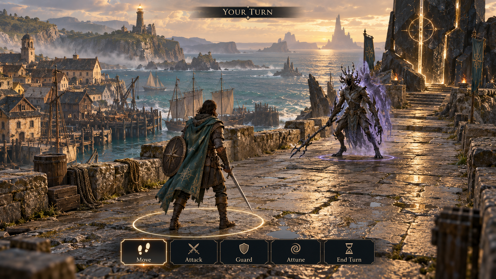

# The Shattered Sea visual reference

Generated concept reference, not a screenshot of the implemented game. It shows
the third-person camera, turn-based action selection, maritime environment and
ancient Lattice art direction. Interface details and creature design are exploratory.

Created with the built-in image generation tool on 2026-10-25.

## Generation prompt

Use case: stylized-concept. Create a polished widescreen 16:9 game reference image for THE SHATTERED SEA, a grounded maritime quantum-fantasy RPG. Third-person gameplay camera behind and slightly above a full-body traveler in weathered leather, sea-green cloak, sword and round shield, facing a Fractured shore creature on a broad stone causeway above Greywake harbour. Keep camera at human gameplay height, never isometric or overhead. Late medieval fishing harbour below with timber houses, ochre plaster, sailing boats, teal ocean, distant islands and a cliff beacon. Ancient charcoal mineral monolith with precise seams and restrained pale-gold Lattice light at the path; subtle violet doubled silhouette on the creature. Golden late-afternoon coastal light, mist, believable PBR materials and readable authored game environment. Show a turn-based battle awaiting player input, both combatants stationary and clearly separated, subtle reachable-area boundary on stone, discreet target ring, compact elegant bottom action bar with exactly 'Move', 'Attack', 'Guard', 'Attune', 'End Turn'; small top label 'YOUR TURN'. Premium restrained RPG interface, no damage-number clutter. Strong environment storytelling, mature painterly realism in a high-quality 3D game screenshot concept. No futuristic guns, neon cyberpunk, top-down camera, or real-world branding. This is concept art, not an actual engine screenshot.
