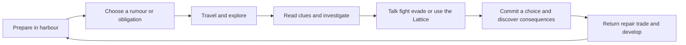

# The Shattered Sea Game Design

The Shattered Sea is a single-player, third-person 3D RPG about exploring an
archipelago, navigating conflicting loyalties and uncovering why reality is
coming apart. The player begins as an ordinary islander and becomes a rare
interface to the ancient Lattice.

This is the proposed playable design, building on the [world concept](game-concept.md)
and [technical architecture](architecture.md). Mechanics, names, quantities and
balance values below are design starting points for prototyping. They do not
describe features already implemented in the starter.

## 1. Player experience

The player should feel curious before they feel powerful. A sail on the horizon,
a missing fisherman and a warm stone in a cold ruin should invite investigation.
Power brings responsibility: repairing a route may help a kingdom while exposing
another island to danger.

| Design pillar | What the player does | Design test |
| --- | --- | --- |
| Discover a believable sea | Read landmarks, follow rumours, enter ruins and find routes | Exploration reveals useful knowledge without requiring a map marker |
| Bend possibilities at a cost | Combine mundane tools with bounded Lattice abilities | Abilities change decisions rather than simply increase damage |
| Choose between credible interests | Help, bargain with or oppose factions | Important choices have understandable benefits and costs |
| Live with a changing world | Revisit ports, routes and people after decisions | Consequences appear in places the player recognizes |
| Uncover the ancient mystery | Compare evidence, witness anomalies and form interpretations | Discoveries answer one question while opening another |

Avoid routine loot showers, mandatory survival upkeep, level-scaled bandits and
unannounced world destruction while the player explores. Maintain uncertainty in
the fiction while keeping the controls and rules readable.

## 2. Core loops

The immediate loop is observe, choose a tool, act and read the response. An
expedition combines several encounters with one meaningful discovery or decision.
The campaign loop expands access to islands and knowledge, rather than merely
raising enemy health and player damage.

Target a first-session reward within ten minutes: identify a useful clue, resolve
a local problem and receive a visible response from a person or place. Target
expeditions of roughly 20–40 minutes, with safe stopping points. These are pacing
goals to measure in playtests.

## 3. Character creation and progression

Choose an appearance, name and background. Backgrounds provide opening knowledge,
equipment and dialogue options; they never lock the player into a class.

| Background | Starting advantage | Opening equipment |
| --- | --- | --- |
| Sailor | Navigation and harbour contacts | Cutlass, rope and a coastal chart |
| Mercenary | Guarding and weapon handling | Sword, shield and worn armour |
| Scholar | Ancient inscriptions and investigation | Staff, field journal and survey tools |
| Smuggler | Concealment and illicit contacts | Short blade, lock tools and hidden cargo lead |
| Healer | Medicine and reading injuries | Staff, treatment kit and herb pouch |
| Lattice Sensitive | Earlier recognition of resonance | Simple blade and an inherited relic |

All backgrounds can awaken Lattice abilities through the opening story. A
Sensitive recognizes some symptoms earlier; it is not the only viable choice.
The first slice uses one preset traveler while character creation remains later work.

Use four attributes: **Might** for force and load, **Finesse** for precision and
evasion, **Insight** for investigation and technical understanding, and **Resolve**
for composure and coherence. Skill tracks cover arms, fieldcraft, seamanship,
lore and attunement. Avoid awarding progress simply for repeatedly using a button.

Award advancement for discoveries, completed objectives and substantial encounters,
including nonviolent resolutions. At milestones, choose a specialization perk
and improve an attribute or skill. Equipment changes tactics; attunement unlocks
new interactions. Final level caps and perk counts follow the first-island tests.

## 4. Movement and camera

Use a third-person, over-the-shoulder camera in both exploration and combat,
with adjustable distance, target framing and collision avoidance. Combat permits
orbiting and inspecting targets while waiting for a decision, retaining the
third-person view rather than switching to an overhead tactical camera.
Walking, running, sprinting,
jumping and contextual interaction form the initial movement set. Mantling and
swimming are separate features to prove before building levels that require them.

Initial land routes use bridges, paths, steps and authored jumps. The first
harbour has barriers or shallow recovery zones where swimming is unavailable.
An accidental fall resets the player to a nearby safe position with clear feedback.

| Input | Initial keyboard and mouse proposal |
| --- | --- |
| Move and look | WASD and mouse |
| Sprint and jump | Shift and Space |
| Interact | E |
| Select and confirm combat action | Left mouse and action bar |
| Cancel action preview | Right mouse |
| End combat turn | Explicit End Turn button |
| Ability slots | 1, 2 and 3 |
| Lock-on | Middle mouse |
| Journal, map and inventory | J, M and I |
| Pause | Escape |

These are remappable defaults. In the current starter Escape quits; implementing
this design replaces that behavior with a pause menu containing an explicit Quit
action. Controller mappings are required for the full game, after the initial
keyboard/mouse interaction is stable.

## 5. Combat

Combat is turn-based. Exploration uses free movement; entering an encounter
establishes participants and a visible initiative order. Each participant takes
one turn per round. There is no decision timer or reflex-based attack input.
Begin with sword/shield and one hostile creature, then add ranged weapons and
additional weapon families after the basic exchange is clear and satisfying.

Prototype each turn with two action points and one movement allowance. A normal
attack, Guard, item use or paid ability costs one action point; a heavy attack
costs two. Movement may be split around actions within the remaining allowance.
Preview reachable positions, path, target, cost and line of sight before
confirmation. Invalid commands consume nothing. End Turn forfeits unused points;
points and movement reset at the next turn. Initiative ties use stable ordering.

Guard lasts until the start of the actor's next turn. Deflect is a prepared
reaction against the next eligible attack before that boundary, with no timing
window. The enemy follows the same action economy. Encounter exit returns to
exploration after victory, surrender or a successful retreat to a marked escape
area. These action-point values are provisional balance settings.

Health measures injury, stamina supports exploration exertion and coherence funds
Lattice manipulation. Combat uses action points and movement rather than a
second stamina cost. Heavy attacks punish exposed targets; Guard reduces incoming
damage. Repositioning is a movement choice rather than a timed dodge. Animations
communicate committed results and never determine success through reflex timing.

Normal attacks use validated range, line of sight and defined damage rules, not hidden hit-chance
rolls. Critical opportunities follow exposed states or positioning. Enemy cues
use animation, sound and shape, not colour alone. Start with small groups of
one to three threats so encounter meaning survives without a large combat system.

Healing spends an action point and resolves as a committed action. Supplies are
limited per expedition but replenishable in settlements. Basic stamina recovers
after exertion; sprinting during a safe journey should not become a repeated wait.

Retreat, stealth routes and conversation can resolve suitable encounters. Their
rewards should support progression comparably to combat, without requiring every
enemy to offer every resolution.

## 6. Lattice abilities

Three concepts govern abilities: coherence is the player's available capacity,
probability distance describes the difficulty of a change, and local resonance
determines how strongly the Lattice can support it.

Start with three resonance bands: weak, normal and strong. Show their meaning
when the player attunes. Dead zones and Nullborn suppression disable specific
abilities explicitly; required progression always has an available supported path.

| Ability | Player action | Limit | Initial prototype cost |
| --- | --- | --- | --- |
| Attune | Reveal nearby Lattice links, stored traces and supported interaction points | Short range; reveals authored evidence, not every hidden object | Free; a short pulse with a brief reuse delay |
| Deflect | Prepare protection against the next eligible incoming attack | Expires at the next own turn; cannot erase explosions or environmental hazards | 1 action point and 20 coherence |
| Threadstep | Move to a visible authored anchor across a short gap | Valid supported landing only; no passing through arbitrary walls | 30 coherence |
| Knit | Accelerate limited tissue recovery | Out of immediate danger; no resurrection or removal of every condition | Later ability, cost to be tested |
| Anchor | Hold one unstable mechanism in a supported state | A marked target for a limited duration | Later ability, cost to be tested |

Prototype with 100 coherence. Outside combat recover 10 per second after four
seconds without casting. During combat recover 10 at the start of each own turn;
waiting in menus never restores resources. Combat cooldowns and status durations
use explicit turn boundaries. Attune costs one action point in combat but remains
free of coherence cost; Threadstep costs one action point plus coherence.
Strong or weak resonance initially changes paid costs by a factor of
0.8 or 1.25. Round costs upward and display the final cost before activation.
These values are deliberately provisional.

Supported ordinary casts produce their described result when validated. Greater
probability distance raises cost or requires a specialization. Do not make the
player randomly fail an ordinary movement ability after committing to a jump.

Later, optional **overchanneling** can reach an otherwise unsupported outcome.
It requires an explicit confirmation of the immediate risk and adds visible
strain. Strain thresholds have authored, telegraphed consequences; disabling
effects never delete inventory or trigger an unexplained campaign catastrophe.
Overchanneling is excluded from the first slice.

Knowledge opens ability uses as often as numerical upgrades. Discovering that
two broken mechanisms share a Lattice connection can matter more than increasing
an ability's radius. Attune remains free to prevent resource-based puzzle locks.

## 7. Exploration and investigation

Every playable island needs a recognizable silhouette, an arrival landmark,
a human conflict, a discovery and a reason to return. Arrange interesting spaces
along readable paths with optional overlooks and shortcuts; do not fill the map
with interchangeable ruins.

Clues come from testimony, physical evidence, inscriptions and Lattice traces.
Store discoveries in a journal under confirmed observations, reported claims and
the player's current leads. Preserve the distinction between what happened and
what an NPC believes happened.

The player can solve an investigation after collecting sufficient evidence in
different orders. Missing an optional clue changes available interpretations,
dialogue or rewards rather than silently blocking the entire campaign. Essential
characters have explicit fallback sources if they become unavailable.

Use objective descriptions with landmarks and directions. Offer optional map
assistance and stronger hints. Attune highlights relevant anomalies, but should
not become a permanent vision filter required for every step.

## 8. Ships and sea travel

The ship is transport, a mobile home and a visible record of the player's journey.
Its first gameplay role is choosing destinations and preparing expeditions.
Acquire a small coastal vessel through an early quest; expand it with navigation,
storage, hull and crew improvements.

Before departure, show destination, known hazards, expected route conditions and
any provision cost. A route may contain a bounded sailing sector or authored
event, followed by an explicit area transition. Avoid several empty real-time
hours between meaningful locations.

Initial crew roles are navigator, deckhand and medic. Crew offers defined benefits
and personal obligations; the first version has no continuously ticking wage or
hunger meter. Ship damage creates repair decisions at safe ports. Full naval
combat, boarding and freely walkable moving ship decks are later expansions.

World changes can close familiar passages or reveal new ones. Communicate known
changes through harbour reports, chart annotations and observable conditions.
A route becomes unavailable before departure when known; a mid-voyage event
always has an authored escape or arrival outcome. Required story routes cannot
disappear without another path becoming available.

## 9. Items and economy

Use a small set of meaningful equipment slots: main hand, off hand, armour,
accessory and relic. Inventory has a readable carrying-capacity limit; quest
evidence is weightless and protected against accidental selling.

Loot should tell the player where they are. A healer's supplies, a Crown seal
and a damaged navigation instrument are more useful world-building than dozens
of nearly identical swords. Use distinctive named upgrades and a few material
tiers rather than random rarity colours on every object.

Early money sinks are supplies, repairs, information, equipment and ship upgrades.
Trading follows authored regional demand with bounded prices, not a fully
simulated global market. Crafting begins as repairs, medicines and selected
upgrades at appropriate stations. Large recipe trees wait until those choices
add value to expeditions.

## 10. Factions and dialogue

Faction responses depend on witnessed actions, agreements, evidence and reputation.
Do not expose a universal good/evil score. Show how a faction describes the
player and provide journal evidence for major relationship changes.

| Faction | Useful offer | Cost or pressure |
| --- | --- | --- |
| Maritime Crown | Protection, port access and supply contracts | Artifact control and political obligations |
| Order of the Veil | Sanctuary, records and genuine containment expertise | Restrictions on Gifted people and artifact use |
| Cartographers' Guild | Charts, expeditions and research contacts | Access to findings and dangerous survey work |
| Keepers | Lattice knowledge and maintenance techniques | Secrecy and selective disclosure |
| Ascendants | Experimental insights and unusual allies | Willingness to expose people to unstable phenomena |

Dialogue choices express intent clearly: question, promise, threaten, disclose,
conceal or refuse. Attribute and background options offer additional approaches;
an unavailable check explains its requirement. Important deception has a defined
consequence and evidence trail, not a hidden arbitrary failure.

The player can work with several factions until specific incompatible commitments
force a choice. Rejection should lead to a different story route rather than
erase hours of unrelated progress.

## 11. Story structure

| Act | Playable focus | Main revelation |
| --- | --- | --- |
| I — The First Fracture | Ordinary island life becomes an investigation | The player can interface with a functioning installation |
| II — The Forgotten Network | Sea travel, alliances and recovery of knowledge | The ruins are parts of one connected system |
| III — The Architects' Legacy | Conflicting evidence and containment decisions | The disappearance may have been a deliberate sacrifice |
| IV — The Choice of Reality | Assemble support and reach the central installation | Every solution changes who survives and how the world functions |

Reveal an apparently impersonal Unmaking first. Introduce repeated patterns,
borrowed memories and eventually responses that suggest developing intention.
Its final nature and the Architects' trapped consciousnesses remain story
decisions to settle before full quest production.

The ending routes are restoration, release and reconstruction. Preparation and
relationships affect their consequences. Reconstruction must require meaningful
discoveries and tradeoffs; it must not invalidate the other endings as obviously
wrong answers or appear as a surprise final dialogue option.

## 12. Opening design and first playable slice

Working location name: **Greywake**, a fishing harbour on a modest island. A
damaged coastal beacon has stopped guiding boats home. A local healer believes
the missing keeper is injured; a Crown representative suspects smuggling.

The player investigates a service path above the harbour, reaches the keeper's
cottage and finds that an ancient foundation beneath the beacon has activated.
The missing keeper is trapped beyond an unstable chamber entrance. A maintenance
log outside the chamber provides a partial account of what happened.

| Beat | Player experience | System being proved |
| --- | --- | --- |
| Arrive at the harbour | Speak to the healer and accept a clear local task | Camera, interaction, dialogue and journal |
| Follow the service path | Inspect abandoned equipment and hear conflicting accounts | Exploration and evidence |
| Reach the cottage | Avoid or fight a Fractured shore creature | One combat exchange and an alternate route |
| Enter the foundation | Activate a relic and use Attune to see a damaged link | Ability feedback and discovery |
| Restore access | Redirect an authored mechanism and rescue the keeper | Simple puzzle, collision and persistent outcome |
| Return to the harbour | Decide who receives the recovered survey record | Reward, relationship flag and visible consequence |

Give the rescued keeper a clear account but incomplete knowledge. The survey
record suggests similar installations on other islands, opening the next
expedition without explaining the Architects immediately.

The slice should take approximately 20–30 minutes. Its committed production
boundary is one harbour area, one short outdoor route and one ruin chamber;
three principal NPCs; one hostile creature type; a preset player; sword/guard;
Attune; one quest with two record-recipient outcomes; subtitles and save/load.
Sailing appears as a destination preview, not a playable feature in this slice.
Ambient townspeople may be simple presentation actors without quest schedules.

Do not require Threadstep, swimming, a movable ship deck, companions, procedural
islands or complex gravity/time effects to complete the slice. The creature can
be bypassed so a combat-balance failure does not block investigation testing.

## 13. Interface and accessibility

Keep the exploration screen quiet. Show health, stamina and coherence during
danger or relevant actions, a small compass, a contextual interaction prompt and
one tracked lead. Display ability cost and suppression reasons near the ability,
not only in a distant journal entry.

The pause interface contains Resume, Journal, Map, Character, Inventory,
Save/Load, Settings and Quit. Journal pages separate quests, evidence, people and
discoveries. Maps distinguish known routes, reported hazards and unexplored
areas. No map panel reveals world truth the player has not learned.

Single-player menus pause simulation. Provide remappable controls, invert axes,
camera sensitivity, adjustable text/UI scale, subtitles with speaker names,
separate volume controls and hold/toggle alternatives. Screen shake, motion blur,
flashing and Fracture distortion must be reducible. Important danger uses sound
and visible shapes; important speech always has text.

Offer adjustable combat damage, action previews and navigation hints. Changing
these settings does not lock story endings or label a save as inferior.

## 14. Visual design

See the [generated game reference](art/game-reference.md) for a third-person
turn-based encounter above Greywake harbour.

Use grounded maritime fantasy with readable shapes and selective detail. Human
spaces use timber, limewash, rope, canvas, bronze, stone and weathered iron.
Architecture shows repair, salt, wind and generations of reuse.

Architect structures have precise repeating proportions, dark mineral surfaces,
fine seams and restrained internal light. Their impossible qualities come from
alignment, reflection and continuity rather than ubiquitous glowing circuitry.
Keep ordinary tools recognizably medieval or Renaissance in form.

| Visual family | Palette and treatment |
| --- | --- |
| Harbours and safe interiors | Warm ochre `#B78A4A`, canvas `#D6CCB3`, worn timber `#5B4636` |
| Sea and exposed coast | Deep teal `#244C55`, slate `#657B84`, pale foam `#DCE5DF` |
| Architects and stable Lattice | Mineral charcoal `#202C32`, restrained pale gold `#E2C98B` |
| Unmaking | Misaligned silhouettes, missing detail and a limited violet accent `#8976AD` |

Palette values guide art direction, not semantic-only UI indicators. Materials
must remain legible in daylight and darkness. Maintain stable terrain and target
silhouettes even when cosmetic Fracture effects are active.

For Greywake, compose the harbour around the beacon on its cliff. The beacon is
visible at arrival, disappears briefly along the service path and returns at the
ruin approach. Its restoration changes a familiar view, making the quest outcome
visible without a notification explaining it.

## 15. Audio and generated content

Build the coast from wind, rigging, gulls, distant surf, timber and working people.
Let ruins become quieter before adding unusual sound. Stable Lattice machinery
uses delicate tonal patterns; the Unmaking disrupts their expected repetition.
Reduce or remove intrusive effects when accessibility settings require it.

Music favors sparse acoustic textures, low strings and occasional voices, with
subtle synthetic tones reserved for ancient installations. Escalation follows
danger and discovery, not a constant epic score.

Use ElevenLabs for reviewed character dialogue, retaining stable line IDs,
subtitle text, pronunciation notes and a consistent approved voice per character.
The existing tool produces speech; sound effects and music need separate
production paths. No live generation is needed during play.

Use Tripo to draft props, ruin elements and selected creature/character bases.
Review silhouette, scale, materials, mesh complexity, usage rights and consistency
before approval. Rigging, animation and collision remain explicit production
work. Generated assets must conform to the art direction, rather than define it.

## 16. Failure and persistence

Support manual saves outside active combat and transitions, plus rotating autosaves
at safe arrivals and major committed decisions. Explain temporary save restrictions.
Loading restores the last committed state; it never reissues a claimed reward.

Death initially reloads the last save. Do not add corpse retrieval or permanent
equipment loss until they are shown to improve the intended experience. Failed
quests can change relationships or remove an optional reward while preserving a
viable campaign route. Failed content loading is a retry/cancel state, not a
fictional character death.

There is no hidden real-time apocalypse timer. Regional escalation follows
explicit campaign milestones or clearly communicated timed tasks. Offer a
non-timed alternative when timing is not essential to the story.

## 17. Scope and acceptance

The world fiction can contain thousands of islands. Production begins with
Greywake, then a three-island archipelago slice. Additional islands earn their
scope through distinct gameplay and story roles. Final campaign length, island
count and voice-line volume remain uncommitted until the slice is measured.

The first slice succeeds when a new player can:

- Understand the keeper's problem and find the first lead without developer help.
- Move, interact and resolve the creature encounter using the available tools.
- Discover Attune's purpose and solve the chamber interaction without resource locks.
- Recognize supported Lattice interactions and explain Attune's resonance indicator.
- Make the record-recipient choice with a reasonable understanding of its stakes.
- See a consequence at the harbour and recover it correctly after save/load.
- Play with reduced visual distortion and readable subtitles.

Collect completion time, missed prompts, camera collisions, deaths, hint requests,
ability misunderstanding and reactions to the final choice. Use these findings
to revise pacing and controls before adding content volume.

The architecture describes how these systems will be implemented. This design
describes what they should feel like and the choices they should support. Keep
both documents aligned when prototype findings change a decision.
